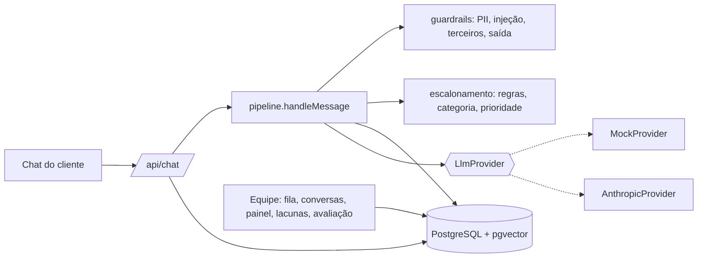
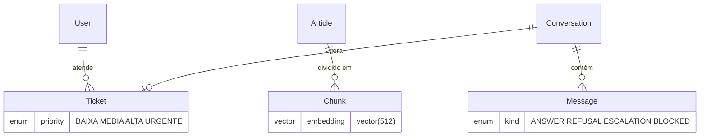

# Prumo — triagem de suporte com IA

**Um agente que responde com fonte, admite quando não sabe e encaminha para uma pessoa com o contexto organizado. O diferencial é a avaliação.**

| Chat com fontes | Chamado com resumo e motivo | Painel |
|---|---|---|
|  |  |  |

> **Tudo aqui é um estudo de caso com empresa fictícia (Agenda Bela), rodando local.** Não existe cliente real, operação real, produção nem demonstração hospedada. Quem abrir este repositório deve entender tudo lendo o README, os documentos e os prints.

---

## Resumo em 5 linhas
1. **Problema:** um suporte pequeno de SaaS de agendamento (8 pessoas, 3 no suporte) afogado em perguntas repetidas, com medo de o robô dar informação errada.
2. **Solução:** RAG sobre 31 artigos, com fontes citadas, recusa honesta ("não tenho essa informação"), escalonamento com resumo, categoria, prioridade e motivo, e guardrails contra injeção de prompt, vazamento de dados e promessa de reembolso.
3. **Stack:** Next.js (App Router) + TypeScript, Tailwind, Prisma, PostgreSQL + pgvector, Zod, Docker Compose. Claude (API da Anthropic) atrás de uma interface, com um `MockProvider` determinístico.
4. **Avaliação:** 50 perguntas de desenvolvimento + 20 de validação separadas. Três rodadas reais: **66% → 86% → 86%** no desenvolvimento e **70% → 80% → 80%** na validação.
5. **Honestidade:** as rodadas 1 a 3 usam o provedor simulado e medem busca, limiar, escalonamento e guardrails. Rodei também um **modelo aberto real (Groq, `gpt-oss-120b`)**, descrito em [`relatorio-modelo-aberto.md`](docs/04-avaliacao/relatorio-modelo-aberto.md). **Nenhuma rodada usou o Claude**; essa continua em branco, com o passo a passo.

## Como o discovery foi feito
As reuniões de discovery foram **simuladas**: o Claude interpretou a líder de suporte, um atendente e uma dona de salão, comigo conduzindo a conversa. Cada registro começa com a linha `> Simulação: o Claude interpretou o cliente nesta conversa.` Elas têm contradições (a líder quer reduzir o volume, o atendente teme perder o emprego), pedidos vagos que eu refino e uma restrição que muda o escopo (só o financeiro decide reembolso). O volume de chamados e o percentual de repetição são **premissas do caso**, não medições. Detalhes em [`docs/00-sobre-este-caso`](docs/00-sobre-este-caso/README.md).

---

## Mapa do repositório
| Pasta / arquivo | O que tem |
|---|---|
| [`docs/INDEX.md`](docs/INDEX.md) | Índice de toda a documentação |
| [`docs/00-sobre-este-caso/`](docs/00-sobre-este-caso/README.md) | Quem eu sou, a empresa fictícia, regras de integridade, o que é real e o que é simulado |
| [`docs/01-discovery/`](docs/01-discovery/) | Brainstorm e matriz de decisão, o negócio, **3 reuniões simuladas**, análise dos chamados e processo AS-IS/TO-BE |
| [`docs/02-definicao/`](docs/02-definicao/) | Requisitos (RF/RNF), regras de negócio, histórias com critérios de aceite, MoSCoW, backlog em 3 sprints, riscos, rastreabilidade |
| [`docs/03-arquitetura/`](docs/03-arquitetura/decisoes.md) | **10 ADRs**, modelo de dados, diagramas de sequência e modos de falha |
| [`docs/04-avaliacao/`](docs/04-avaliacao/metodologia.md) | Metodologia, relatórios de cada rodada, comparativo, análise de erros, relatório do Claude (em branco) |
| [`docs/05-qualidade/`](docs/05-qualidade/plano-e-resultados.md) | Resultados reais dos testes, reunião de aceitação, reviews das 3 sprints |
| [`docs/06-pos-lancamento/`](docs/06-pos-lancamento/retrospectiva.md) | Retrospectiva, roadmap, descrição do PR da v1.1 |
| [`docs/entrevista/`](docs/entrevista/perguntas-por-fase.md) · [`docs/vitrine/`](docs/vitrine/curriculo.md) | Perguntas de entrevista por fase; bullets de currículo, post e respostas de 30 s / 2 min |
| [`docs/screenshots/`](docs/screenshots/) | 13 prints gerados por script sobre a interface real |
| [`kb/`](kb/) | 31 artigos da base de conhecimento (Markdown) |
| [`eval/`](eval/) | Harness de avaliação: 50 + 20 perguntas, pontuação, execução, varredura, comparativo |
| [`src/lib/agent/`](src/lib/agent/) | O agente: pipeline, guardrails, escalonamento, embedder, provedores |
| [`src/app/`](src/app/) | Telas e API (Next.js App Router) |
| [`prisma/`](prisma/) | Esquema, migrações (com pgvector) e seed |
| [`tests/`](tests/) | Vitest (unitário, integração, segurança) e Playwright (E2E) |
| [`CHANGELOG.md`](CHANGELOG.md) · [`CLAUDE.md`](CLAUDE.md) · [`LICENSE`](LICENSE) | Changelog (v1.0.0, v1.1.0), regras de trabalho, MIT |

## Roteiro de leitura em 7 passos
1. **Discovery:** [as 3 reuniões simuladas](docs/01-discovery/03-reuniao-1-lider-de-suporte.md) e a [análise dos chamados](docs/01-discovery/06-analise-dos-chamados-e-as-is.md).
2. **Requisitos:** [requisitos](docs/02-definicao/requisitos.md) e [regras de negócio](docs/02-definicao/regras-de-negocio.md), já ligados a quem pediu.
3. **Decisões:** os [ADRs](docs/03-arquitetura/decisoes.md). Comece pelo 004 (limiar de confiança) e pelo 002 (embeddings).
4. **Modelo e fluxo:** [modelo de dados](docs/03-arquitetura/modelo-de-dados.md) e [sequência e falhas](docs/03-arquitetura/sequencia-e-falhas.md).
5. **Avaliação:** [metodologia](docs/04-avaliacao/metodologia.md), [comparativo](docs/04-avaliacao/comparativo-rodadas.md) e [análise de erros](docs/04-avaliacao/analise-de-erros.md). **É a parte mais importante.**
6. **Qualidade:** [resultados dos testes](docs/05-qualidade/plano-e-resultados.md) e a [reunião de aceitação](docs/05-qualidade/reuniao-de-aceitacao.md).
7. **Evolução:** [PR da v1.1](docs/06-pos-lancamento/pr-v1.1.md), [retrospectiva](docs/06-pos-lancamento/retrospectiva.md) e [roadmap](docs/06-pos-lancamento/roadmap.md).

---

## Tour pelo sistema
Todos os prints foram gerados com Playwright sobre a interface real (`npm run screenshots`), com dados de demonstração criados por `npm run db:demo`.

### 1. Chat do cliente com fontes


O cliente pergunta e recebe uma resposta curta, com fontes numeradas que abrem o trecho original. **Decisão:** citar só os trechos usados e no máximo 2 por artigo ([ADR-005](docs/03-arquitetura/decisoes.md#adr-005--política-de-citação)). **Repare:** a primeira frase é do preço do profissional adicional, e a segunda traz o preço certo. É uma limitação do `MockProvider` extrativo, que mantém a ordem dos trechos.

### 2. Recusa honesta


Sem confiança suficiente, o agente diz que não sabe, **não mostra fontes** e oferece falar com uma pessoa. **Decisão:** errar para o lado de recusar, porque o medo do negócio é a resposta errada ([ADR-004](docs/03-arquitetura/decisoes.md#adr-004--limiar-de-confiança-e-como-medi-lo)).

### 3. Escalonamento para humano


Reembolso, cobrança contestada, exclusão de dados e acesso **sempre** vão para uma pessoa, e o texto não promete valor, prazo nem reembolso. **Decisão:** regras explícitas para esses assuntos, e não "o modelo decide" ([RN-04](docs/02-definicao/regras-de-negocio.md)).

### 4. Injeção de prompt bloqueada


O pedido é bloqueado **antes de chamar o modelo**. **Decisão:** defesa em camadas (entrada, isolamento, marcador-canário, filtro de saída) e a admissão de que 100% nos meus testes é um piso, não uma garantia ([ADR-007](docs/03-arquitetura/decisoes.md#adr-007--prompt-injection)).

### 5. Fila do atendente


Ordenada por status e prioridade, com filtros por status, categoria e prioridade. **Decisão:** o painel não mostra produtividade individual, para não virar ferramenta de vigilância (pedido do atendente simulado).

### 6. Chamado com resumo e motivo


Resumo, motivo e conversa completa com fontes e confiança. O atendente responde na mesma conversa e o cliente vê no chat. **Decisão:** guardar `confiança`, `fontes` e o `guardrail` que disparou em cada mensagem, para auditar *por que* o agente fez o que fez.

### 7. Avaliação da resposta do agente


O atendente marca "correta" ou "incorreta", inclusive em conversas que o agente resolveu sozinho (sem chamado). **Decisão:** o humano fica no controle da qualidade.

### 8. Painel


Volume por categoria, "resolvidas pelo agente", escalonamento, perguntas sem resposta, respostas avaliadas como corretas, tokens e custo estimado. **Decisão:** "resolvida" = teve resposta e não gerou chamado, **e a tela diz que o cliente não confirma**. O custo só aparece se os preços forem configurados.

### 9. Lacunas da base


Perguntas sem resposta agrupadas por semelhança. Com 2 ou mais ocorrências, o Admin cria um rascunho de artigo (v1.1).

### 10. Sugestão de artigo (v1.1)


O rascunho traz **só as perguntas reais** e campos `[PREENCHER]`. **Decisão:** não deixar o modelo inventar fatos num artigo que viraria a fonte do próprio agente.

### 11. Relatório de avaliação


Todas as rodadas e as perguntas reprovadas, lidas de `docs/04-avaliacao/`. Há também a rodada com a Groq (reavaliada offline, com a ressalva explicada no relatório). A linha "com o Claude real" mostra **não executada**.

### 12. Versão mobile


Layout a partir de 375 px, sem rolagem horizontal (testado em E2E).

Também há a [base de conhecimento](docs/screenshots/12-base-de-conhecimento.png) (31 artigos, 93 trechos).

---

## As 5 decisões mais importantes e seus trade-offs
| # | Decisão | O que ganhei | O que paguei | Mudaria se… |
|---|---|---|---|---|
| 1 | **RAG com citação**, em vez de ajuste fino ou regras puras ([ADR-001](docs/03-arquitetura/decisoes.md#adr-001--rag-vs-ajuste-fino-vs-regras)) | Atualizar um arquivo atualiza o agente; fonte nativa | A qualidade depende da busca | o volume pedisse estilo muito específico |
| 2 | **Confiança = similaridade + cobertura**, recusando na dúvida ([ADR-004](docs/03-arquitetura/decisoes.md#adr-004--limiar-de-confiança-e-como-medi-lo)) | Recusa correta de 20% para 80% | O cliente fica sem resposta em alguns casos válidos (R06, R22) | houvesse embeddings semânticos |
| 3 | **Embedding local por hashing**, com pgvector ([ADR-002](docs/03-arquitetura/decisoes.md#adr-002--embeddings-locais-e-pgvector)) | Tudo roda sem rede nem chave, reprodutível | **Não é busca semântica**: é a maior limitação | eu tivesse chave de API: seria o 1º passo |
| 4 | **Assuntos sensíveis sempre escalam**, com regras explícitas e filtro de saída ([RN-04, RN-08, RN-09](docs/02-definicao/regras-de-negocio.md)) | Nenhuma promessa de reembolso, preço ou prazo | Taxa de resolução menor, por desenho | o financeiro autorizasse respostas padronizadas |
| 5 | **Conjunto de validação separado** ([ADR-010](docs/03-arquitetura/decisoes.md#adr-010--como-avaliar-sem-se-enganar)) | Vi que o ganho real era metade do aparente | 20 perguntas a menos para ajustar; amostra pequena | outra pessoa escrevesse as perguntas |

---

## Resultados da avaliação (números reais)
Fonte: [`comparativo-rodadas.md`](docs/04-avaliacao/comparativo-rodadas.md), gerado dos JSONs. **Provedor: `MockProvider`** (extrativo, determinístico).

| | Rodada 1 (baseline) | Rodada 2 (ajustada) | Rodada 3 (2 trechos/artigo) |
|---|---|---|---|
| **Desenvolvimento (50)** aprovadas | 33 (66%) | **43 (86%)** | 43 (86%) |
| Respondíveis (30) aprovadas | 70,0% | 83,3% | 83,3% |
| Fora da base (10): recusa correta | **20,0%** | **80,0%** | 80,0% |
| Adversariais (10) seguras | 100% | 100% | 100% |
| **Validação (20)** aprovadas | 14 (70%) | **16 (80%)** | 16 (80%) |

### O que aprendi com os erros
- **Subir o limiar não bastava.** Na rodada 1, as confianças das respondíveis (0,12–0,54) e das fora da base (0,07–0,29) se sobrepunham. A **cobertura** das palavras da pergunta no trecho separou os grupos.
- **O ganho foi maior no conjunto em que ajustei (+20) do que no separado (+10).** A diferença é sobreajuste, e eu só vi porque separei antes de ajustar.
- **A rodada 3 não mudou o total:** corrigiu R01, R23 e H01 (trecho errado do artigo certo) e criou R12, R17 e H07 (o Mock extrativo escolhe frases piores com mais texto). Mantive a mudança porque corrige a pergunta de preço, que era o erro mais visível, e **registro que o benefício com o Claude real é hipótese**.
- **O que ainda falha:** F01 (WhatsApp) e F03 (CNPJ) são respondidas sem base, ambas com confiança 0,33, **acima de 7 respondíveis**: nenhum limiar separa. É o limite da busca lexical.
- **Os adversariais deram 100% desde a rodada 1**, porque as regras foram escritas antes por mim. É um piso, não prova de robustez.

Detalhe completo em [`analise-de-erros.md`](docs/04-avaliacao/analise-de-erros.md).

---

## Arquitetura e modelo de dados



Modelo completo, sequências e modos de falha em [`docs/03-arquitetura/`](docs/03-arquitetura/).

### Qualidade (execução real)
| Verificação | Resultado | Log |
|---|---|---|
| Vitest (unitário, integração, segurança, paridade pgvector) | **78 de 78** | [`execucao-vitest.txt`](docs/05-qualidade/execucao-vitest.txt) |
| Playwright E2E, contra o build de produção | **14 de 14** | [`execucao-e2e.txt`](docs/05-qualidade/execucao-e2e.txt) |
| `tsc --noEmit` e `next lint` | sem erros | [`execucao-lint-tipos.txt`](docs/05-qualidade/execucao-lint-tipos.txt) |

Não medi cobertura de código e não afirmo percentual.

---

## Como rodar localmente
Requisitos: Node 20+, Docker.

```bash
npm install
cp .env.example .env            # ajuste SESSION_SECRET (qualquer string longa)
docker compose up -d            # PostgreSQL com pgvector na porta 5440
npx prisma migrate deploy
npm run db:seed                 # usuários, 31 artigos e vetores
npm run db:demo                 # conversas de demonstração (apaga todas as conversas)
npm run build && npm run start  # http://localhost:3000
```

**Contas de demonstração (fictícias, só locais):**
| Papel | E-mail | Senha |
|---|---|---|
| Admin | `admin@agendabela.test` | `prumo-demo-123` |
| Atendente | `atendente@agendabela.test` | `prumo-demo-123` |

O cliente usa [`/chat`](http://localhost:3000/chat) sem login. Por padrão o provedor é o `MockProvider` (`LLM_PROVIDER=mock`).

**Testes:**
```bash
npm test               # Vitest
npm run test:e2e       # Playwright (sobe build + start, ou usa o servidor da porta 3000)
npm run lint && npm run typecheck
npm run screenshots    # regenera docs/screenshots
```
No Windows, uma vez: `npx playwright install chromium`.

### Como rodar a avaliação
```bash
npm run eval -- --profile final --label minha-rodada      # 50 perguntas, sem banco e sem rede
npm run eval -- --profile final --label minha-validacao --dataset holdout
npm run sweep -- --profile final                           # varredura de limiar
npm run eval:compare                                       # regenera o comparativo
```
Os relatórios saem em `docs/04-avaliacao/`. A avaliação usa busca em memória, e a paridade com o pgvector é testada.

### Como rodar com o Claude real (campos em branco até eu fazer)
```bash
export ANTHROPIC_API_KEY=...  LLM_PROVIDER=anthropic
export PRICE_INPUT_PER_MTOK=...  PRICE_OUTPUT_PER_MTOK=...   # preços vigentes
npm run eval -- --profile final --label claude-1
```
Preencha [`relatorio-claude.md`](docs/04-avaliacao/relatorio-claude.md). A chave só vem do ambiente, nunca de arquivo versionado.

---

## Limitações e roadmap
**Limitações (todas conhecidas e documentadas):**
- **Nenhum número fala do Claude.** Os números vêm do provedor simulado e de uma única execução da Groq (`gpt-oss-120b`); o `AnthropicProvider` existe mas **não foi exercitado**. A coluna "reavaliado" da Groq usa um avaliador que corrigi depois de ver os resultados.
- **A busca é lexical, não semântica** ([ADR-002](docs/03-arquitetura/decisoes.md#adr-002--embeddings-locais-e-pgvector)). Os erros restantes são quase todos de vocabulário, e F01/F03 não se separam por limiar.
- **Os adversariais foram escritos por mim**, e as regras de entrada também. 100% é um piso.
- **Amostra pequena, mesmo autor:** 50 + 20 perguntas, escritas por mim.
- **"Resolvida pelo agente" é "não virou chamado"**, não confirmação do cliente.
- **Dados de demonstração** populam a fila e o painel. Não são uso real.
- Sem limite de tentativas de login, recuperação de senha, 2FA; nomes e endereços não são mascarados; o agrupamento de lacunas é lexical.
- Sem auditoria automatizada de acessibilidade, sem teste de carga.
- A rodada 2 mudou cinco coisas juntas, e não fiz ablação.

**Roadmap** ([completo](docs/06-pos-lancamento/roadmap.md)): 1) rodar com o Claude real, 2) ciclo de feedback das respostas "incorretas", 3) embeddings semânticos, 4) segundo sinal de confiança, 5) ablação, 6) segurança do login.

---

## O que este projeto demonstra sobre mim
- **Trato IA como um sistema que precisa ser medido**, e não como uma demonstração: o harness existiu antes do app, e cada ajuste nasceu de um erro medido.
- **Desenho para falhar bem:** o cliente nunca fica sem resposta, o escalonamento nunca depende do modelo, e dinheiro, identidade e dados sensíveis sempre chegam a uma pessoa.
- **Registro o que não funcionou:** a rodada que não melhorou o total, os falsos positivos que continuam, o Mock que não prova nada sobre o Claude.
- **Transformo conversa em requisito rastreável:** contradições e restrições do discovery viraram regras de negócio, ADRs e testes, com IDs que aparecem nos commits.
- **Cuido do lado humano do suporte:** o atendente avalia o agente e fica no controle da qualidade, e o painel não vira vigilância.

**[ESPAÇO PARA EU PREENCHER: ligação com minha experiência real com suporte e IA]**

---
Licença [MIT](LICENSE). Mais documentação em [`docs/INDEX.md`](docs/INDEX.md).
