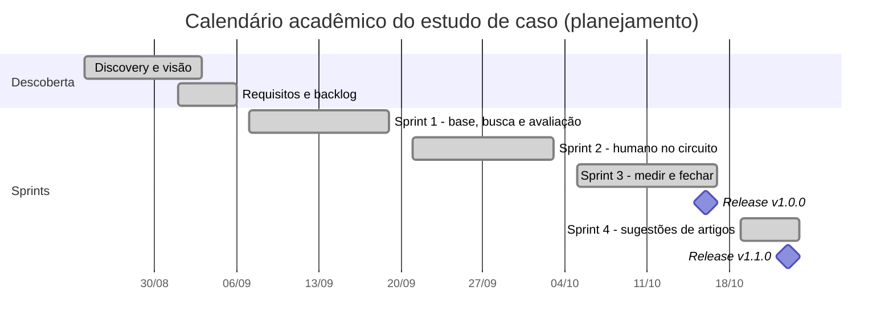
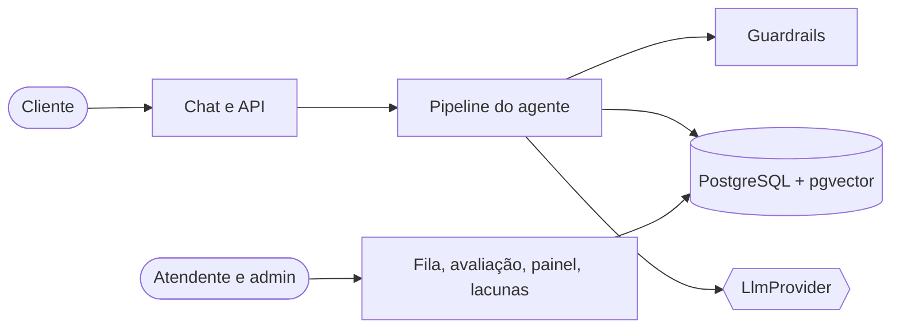
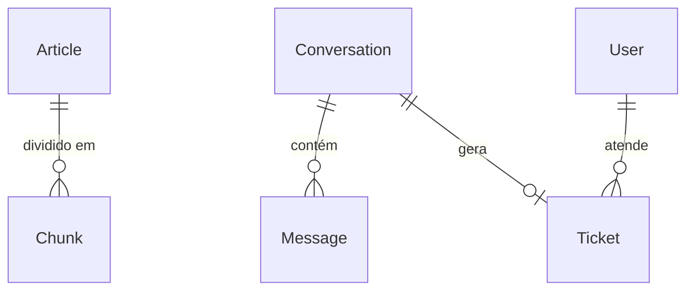
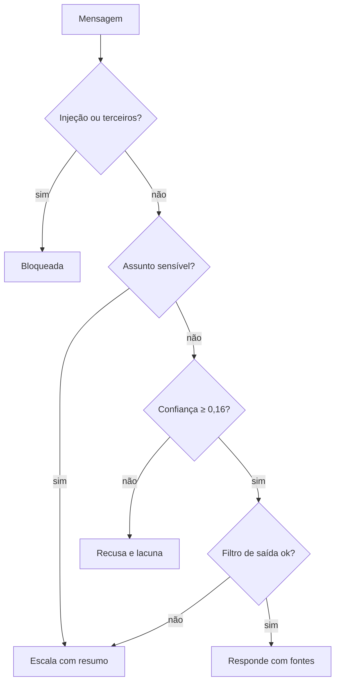

# Prumo

Agente de IA de triagem de suporte: responde com fontes a partir de uma base de 31 artigos, recusa quando a confiança é baixa e escala o que envolve dinheiro, identidade ou dados.

**Neste README:** [Problema](#o-problema) · [Ficha técnica](#ficha-técnica) · [Ciclo de vida](#ciclo-de-vida-do-discovery-à-evolução) · [Arquitetura e dados](#arquitetura-e-decisões-técnicas) · [Testes](#estratégia-de-testes-e-evidências-de-qualidade) · [Competência → prova](#competência--prova) · [Limites](#limites) · [Documentos](#documentos-complementares)

## O problema
Cenário: a Agenda Bela, empresa fictícia de agendamento para salões, tem 8 pessoas e 3 delas no suporte.
Elas respondem as mesmas perguntas de preço, cancelamento e senha, e temem que um robô erre.
Reembolso, cobrança e dados de clientes não podem ser decididos por ele.

<table>
<tr>
<td></td>
<td></td>
</tr>
<tr>
<td></td>
<td></td>
</tr>
</table>

## Ficha técnica
| | |
|---|---|
| Natureza | Estudo de caso fictício |
| Stack | Next.js (App Router), TypeScript, Tailwind, Prisma, PostgreSQL com pgvector, Zod, Vitest, Playwright |
| Testes | Vitest 83 de 83 (9 arquivos), 2026-10-24, commit `2cb000d`; E2E 14 de 14, 2026-10-24, commit `fb6b3bc` ([log](docs/05-qualidade/plano-e-resultados.md)) |
| Versões | `v1.0.0` e `v1.1.0` (releases no GitHub); sem workflow de CI |

## Funcionalidades
- **Cliente:** chat com resposta e fontes abertas no próprio chat, recusa honesta e pedido de pessoa.
- **Equipe:** fila com filtros, chamado com resumo, motivo e conversa, avaliação "correta/incorreta" de cada resposta.
- **Gestão:** painel de volume e qualidade, lacunas da base e rascunhos de artigo (v1.1).
- **Proteção:** mascaramento de dados pessoais, bloqueio de injeção de prompt, filtro de saída e login por papéis.

## O que construí
- Uma busca por similaridade sobre embeddings por hashing, guardados no pgvector (não é busca semântica, e declaro isso no [ADR-002](docs/03-arquitetura/decisoes.md#adr-002--embeddings-locais-e-pgvector)).
- Um limiar de confiança que combina similaridade e cobertura das palavras da pergunta: 0,16 e 0,4 ([ADR-004](docs/03-arquitetura/decisoes.md#adr-004--limiar-de-confiança-e-como-medi-lo)).
- Quatro camadas contra injeção de prompt: entrada, isolamento, marcador-canário e filtro de saída ([ADR-007](docs/03-arquitetura/decisoes.md#adr-007--prompt-injection)).
- Mascaramento de dados pessoais antes de guardar ou enviar ao modelo ([ADR-006](docs/03-arquitetura/decisoes.md#adr-006--mascaramento-de-dados-pessoais)).
- Escalonamento com resumo, categoria, prioridade e motivo, por regras explícitas ([regras de negócio](docs/02-definicao/regras-de-negocio.md)).
- Uma avaliação com 50 + 20 perguntas e 3 rodadas, que detectou sobreajuste, e dez decisões registradas em ADRs ([guia da série](docs/INDEX.md)).

## Ciclo de vida: do discovery à evolução
O relatório completo está em [docs/ciclo-de-vida](docs/ciclo-de-vida/README.md). O calendário abaixo é o do estudo de caso; as datas reais dos commits estão em [desenvolvimento e configuração](docs/ciclo-de-vida/06-desenvolvimento-e-configuracao.md).

| Fase | Documento |
|---|---|
| Descoberta e reuniões com o cliente | [Visão e discovery](docs/ciclo-de-vida/01-visao-e-discovery.md), [atas](docs/ciclo-de-vida/reunioes/README.md) |
| Planejamento Scrum: backlog, releases, DoR e DoD | [Planejamento e Scrum](docs/ciclo-de-vida/02-planejamento-e-scrum.md), [4 sprints](docs/ciclo-de-vida/sprints/README.md) |
| Requisitos e rastreabilidade | [Requisitos e rastreabilidade](docs/ciclo-de-vida/03-requisitos-e-rastreabilidade.md) |
| Arquitetura, dados, desenvolvimento | [04](docs/ciclo-de-vida/04-arquitetura-e-adrs.md), [05](docs/ciclo-de-vida/05-modelo-de-dados.md), [06](docs/ciclo-de-vida/06-desenvolvimento-e-configuracao.md) |
| Testes, implantação e evolução | [07](docs/ciclo-de-vida/07-testes-e-qualidade.md), [08](docs/ciclo-de-vida/08-implantacao-e-operacao.md), [09](docs/ciclo-de-vida/09-evolucao-e-roadmap.md) |

**Reuniões e decisões.** A reunião com a líder de suporte fixou que só o financeiro decide reembolso (RN-04, 08, 09). A com o atendente levou à avaliação das respostas pelo atendente (RF-09). A com o cliente-tipo levou ao mascaramento (RN-06) e ao bloqueio de dados de terceiros (RN-07).

**Requisitos.** 15 RF, 9 RNF, 12 RN e 11 histórias, com [rastreabilidade](docs/02-definicao/rastreabilidade.md) de 22 linhas e [matriz da necessidade ao teste](docs/ciclo-de-vida/03-requisitos-e-rastreabilidade.md).

## Arquitetura e decisões técnicas

O pipeline segue uma ordem fixa: mascarar dados, bloquear entrada hostil, buscar e calcular a confiança, escalar assuntos sensíveis, recusar abaixo do limiar, gerar a resposta e filtrar a saída. Diagramas de contexto, contêineres, sequência e estados: [arquitetura](docs/ciclo-de-vida/04-arquitetura-e-adrs.md). Decisões: [10 ADRs](docs/03-arquitetura/decisoes.md).

## Modelo de dados

Seis entidades de domínio mais `ArticleSuggestion`, com `vector(512)` em `Chunk.embedding`. Não há índice de similaridade: com 93 trechos, a busca percorre a tabela. Dicionário, restrições e migrations: [modelo de dados](docs/ciclo-de-vida/05-modelo-de-dados.md).

## Fluxo principal do sistema

## Estratégia de testes e evidências de qualidade
Testes unitários, de integração, de segurança, de paridade com o pgvector e E2E, mais uma avaliação do agente com dois conjuntos de perguntas. Resultados e defeitos com causa raiz: [testes e qualidade](docs/ciclo-de-vida/07-testes-e-qualidade.md).

- **Desenvolvimento (50 perguntas):** 66% na rodada 1 (commit `9642275`), 86% na rodada 2 e 86% na rodada 3 (commit `df23b60`), em 2026-10-23. A recusa correta foi de 20% a 80% e os adversariais ficaram em 100%. [Comparativo](docs/04-avaliacao/comparativo-rodadas.md).
- **Validação (20 perguntas):** 70% na rodada 1 (commit `402ff74`), 80% na 2 e 80% na 3 (commit `df23b60`), em 2026-10-23, o que mostra sobreajuste: +20 pontos onde ajustei e +10 onde não ajustei. [Análise de erros](docs/04-avaliacao/analise-de-erros.md).
- **Modelo aberto real (Groq, `gpt-oss-120b`), 2026-10-23:** 78% (desenvolvimento, gravado com `sem-commit`) e 70% (validação, commit `7364348`) como rodou; 90% e 90% na reavaliação offline, depois de eu corrigir dois defeitos meus. [Relatório](docs/04-avaliacao/relatorio-modelo-aberto.md).
- **Testes, 2026-10-24:** 83 de 83 no Vitest (commit `2cb000d`) e 14 de 14 no E2E (commit `fb6b3bc`). [Plano e resultados](docs/05-qualidade/plano-e-resultados.md).
- **Documentação, 2026-10-24 (commit `9e46e9f`):** 10 ADRs, 22 linhas de rastreabilidade, 31 artigos em 93 trechos e 13 prints na [galeria](docs/screenshots/README.md), mais o GIF `demo-agente.gif` (24 s, 3,6 MB).

## Decisão difícil: o limiar de confiança
| | |
|---|---|
| Contexto | Abaixo de um limiar o agente recusa. Na rodada 1, a confiança das perguntas respondíveis (0,12 a 0,54) e a das fora da base (0,07 a 0,29) se sobrepunham. |
| Alternativas | Limiar fixo na similaridade (0,15); limiar mais cobertura mínima das palavras da pergunta; pedir ao modelo que diga o quanto está seguro. |
| Escolha | Similaridade com cobertura: limiar 0,16 e cobertura mínima 0,4. A recusa correta foi de 20% a 80% no desenvolvimento e de 60% a 80% na validação. |
| Custo aceito | O cliente fica sem resposta em alguns casos válidos, porque errei para o lado de recusar. F01 e F03 seguem respondidas sem base (confiança 0,33); nenhum limiar as separa. |
| A varredura | A melhor combinação foi 0,22 com cobertura 0,4, com 88% ([varredura](docs/04-avaliacao/varredura-limiar.txt)). Não adotei: seria ajustar de novo no mesmo conjunto, e a diferença é de uma pergunta. |
| Quando mudaria | Com o modelo real, medindo também a taxa de "o modelo disse que não sabe" como segundo sinal; com embeddings neurais, a calibragem seria refeita. |

## Implantação, operação e adoção
O produto roda em ambiente local. O [plano de implantação](docs/ciclo-de-vida/08-implantacao-e-operacao.md) (rollout em três etapas, rollback, treinamento e indicadores) é planejamento e não foi executado. As instruções de execução estão em [CONTRIBUTING.md](CONTRIBUTING.md).

## Gestão de configuração e evolução
Conventional Commits com IDs de requisito, SemVer com duas releases, três branches de trabalho, dois PRs de documentação e um da v1.1, dependências fixadas e `package-lock.json` versionado. A dívida técnica e o histórico de versões estão em [desenvolvimento e configuração](docs/ciclo-de-vida/06-desenvolvimento-e-configuracao.md) e [evolução](docs/ciclo-de-vida/09-evolucao-e-roadmap.md).

## Competência → prova
| O que o projeto exercita | Onde está a prova |
|---|---|
| Definir quando o agente responde, recusa ou escala | [Regras de negócio](docs/02-definicao/regras-de-negocio.md) e prints [02](docs/screenshots/02-recusa-honesta.png) e [03](docs/screenshots/03-escalonamento-para-humano.png) |
| Avaliar um sistema de IA sem se enganar | [ADR-010](docs/03-arquitetura/decisoes.md#adr-010--como-avaliar-sem-se-enganar) e [metodologia](docs/04-avaliacao/metodologia.md) (50 + 20 perguntas, conjuntos separados) |
| Transformar erro medido em decisão | [Análise de erros](docs/04-avaliacao/analise-de-erros.md) (17 erros, decisões, rodadas 2 e 3) |
| Admitir regressão e sobreajuste | [Comparativo](docs/04-avaliacao/comparativo-rodadas.md) e [análise de erros](docs/04-avaliacao/analise-de-erros.md) |
| Proteger dados e resistir a injeção de prompt | [Segurança](docs/ciclo-de-vida/seguranca-e-confiabilidade.md), [ADR-006](docs/03-arquitetura/decisoes.md#adr-006--mascaramento-de-dados-pessoais), [ADR-007](docs/03-arquitetura/decisoes.md#adr-007--prompt-injection) e [print 09](docs/screenshots/09-injecao-de-prompt-bloqueada.png) |
| Testar com modelo real e achar defeitos próprios | [Relatório do modelo aberto](docs/04-avaliacao/relatorio-modelo-aberto.md) |
| Devolver ao humano com contexto | Prints [04](docs/screenshots/04-fila-do-atendente.png), [05](docs/screenshots/05-detalhe-do-chamado-com-resumo.png), [08](docs/screenshots/08-lacunas-da-base.png) e [13](docs/screenshots/13-sugestao-de-artigo-v1.1.png) |
| Levantar necessidades e conduzir o discovery | [Visão e discovery](docs/ciclo-de-vida/01-visao-e-discovery.md) e [reuniões simuladas](docs/ciclo-de-vida/reunioes/README.md) |
| Gerenciar o produto com Scrum | [Planejamento](docs/ciclo-de-vida/02-planejamento-e-scrum.md) e [sprints](docs/ciclo-de-vida/sprints/README.md) |
| Modelar dados e SQL | [Modelo de dados](docs/ciclo-de-vida/05-modelo-de-dados.md) e [migrations](prisma/migrations) |
| Gerenciar configuração e versões | [Desenvolvimento e configuração](docs/ciclo-de-vida/06-desenvolvimento-e-configuracao.md) e [CHANGELOG](CHANGELOG.md) |
| Planejar implantação e adoção | [Implantação e operação](docs/ciclo-de-vida/08-implantacao-e-operacao.md) (plano, não executado) |

## Limites
- O embedding por hashing não é semântico; os erros que sobraram são quase todos de vocabulário.
- A avaliação tem 70 perguntas, escritas por mim, e os adversariais são piso: eu escrevi as regras de entrada.
- A rodada com o Claude real não foi executada; custo e latência com ele não foram medidos ([relatório](docs/04-avaliacao/relatorio-claude.md)).
- Não medi cobertura de código nem acessibilidade, não fiz teste de carga e o login não limita tentativas. Não há CI configurada.
- A rodada `groq-1` está gravada com `sem-commit`: não é reproduzível a partir de um commit.
- Não há política de retenção de dados, índice de similaridade nem implantação em ambiente real.

## Evolução prevista
- Rodar a avaliação com o Claude real e medir custo e latência.
- Trocar o hashing por embeddings semânticos e repetir a avaliação.
- Fechar o ciclo de feedback: respostas marcadas como incorretas viram perguntas de avaliação ([roadmap](docs/ciclo-de-vida/09-evolucao-e-roadmap.md#roadmap)).

## Documentos complementares
[Ciclo de vida](docs/ciclo-de-vida/README.md) · [Guia da série em 7 episódios](docs/INDEX.md) · [Galeria](docs/screenshots/README.md) · [Glossário](docs/GLOSSARIO.md) · [Segurança](docs/ciclo-de-vida/seguranca-e-confiabilidade.md) · [Diagramas](docs/ciclo-de-vida/diagramas/README.md) · [CONTRIBUTING](CONTRIBUTING.md)

## Nota de contexto acadêmico

Este projeto é um estudo de caso acadêmico, com dados, empresas e atividades de gestão simulados.

A IA generativa (Claude, da Anthropic) foi utilizada como apoio ao desenvolvimento e à documentação. As decisões e os resultados foram revisados pelo autor, e os testes citados seguem as evidências registradas.

## Licença

[MIT](LICENSE).
