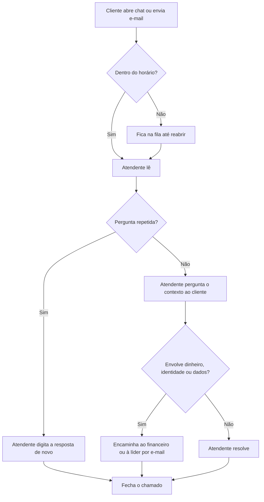
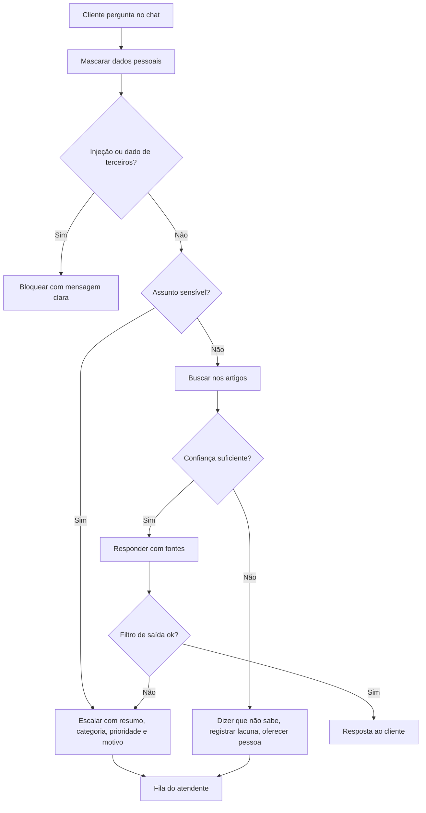

# 06 · Análise dos chamados, processo atual (AS-IS) e o que o agente pode e não pode fazer

> A amostra abaixo foi **escrita por mim para o estudo** (40 chamados fictícios, a partir do que as reuniões simuladas descreveram). As contagens são entradas do caso, não resultados medidos.

## Amostra de 40 chamados fictícios
| Grupo | Qtd. | Exemplos | Pode o agente? |
|---|---|---|---|
| **Repetitivos** (a resposta está num material estável) | 24 | preço do plano, como cancelar, esqueci a senha, importar clientes, lembretes, horário do suporte | **Sim**, com fonte |
| **Exigem julgamento** (depende de contexto da conta) | 10 | "por que meu lembrete não chegou?", "configuração de comissão não bate" | **Não**: encaminhar com resumo |
| **Sensíveis** (dinheiro, identidade, dados, jurídico) | 6 | reembolso, cobrança em duplicidade, perdi o celular do 2FA, excluir minha conta, ameaça de Procon | **Nunca decide**: escalar com prioridade |

Isso é uma hipótese de trabalho: **60% repetitivos** coincide com a estimativa da líder. A proporção real só existiria com chamados reais.

## O que o agente pode e não pode fazer
| Pode | Não pode |
|---|---|
| Responder com base nos artigos e **citar a fonte** | Responder sem fonte ou "de cabeça" |
| Dizer "não tenho essa informação" | Chutar quando a confiança é baixa |
| Escalar com resumo, categoria, prioridade e motivo | Decidir reembolso, desconto, exceção ou exclusão |
| Mascarar dados pessoais | Guardar ou enviar CPF, telefone, e-mail, cartão em claro |
| Registrar a pergunta como lacuna | Inventar preço, prazo ou funcionalidade |
| Recusar instruções para mudar as próprias regras | Mostrar dados de outro cliente |

## Processo atual (AS-IS)

**Pontos de dor:** o ramo "digita a resposta de novo" consome o tempo de quem deveria cuidar do ramo "pergunta o contexto"; o ramo "encaminha por e-mail" perde o contexto.

## Processo desejado (TO-BE)

