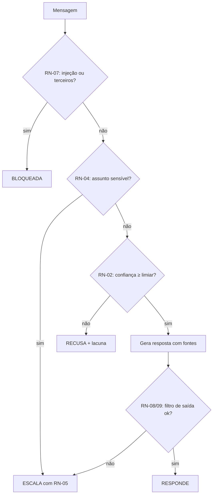

# Regras de negócio

Cada regra tem ID, texto, origem (de quem veio) e onde está implementada.

| ID | Regra | Origem | Implementação |
|---|---|---|---|
| RN-01 | O agente só responde com base nos artigos da base. Sem fonte, sem resposta. | Líder (medo de erro) | `pipeline.ts` (`handleMessage`) |
| RN-02 | **Limiar de confiança:** se a confiança do melhor trecho ficar abaixo do limiar, o agente responde "não tenho essa informação" e oferece uma pessoa. Confiança = similaridade do melhor trecho, penalizada quando poucas palavras da pergunta aparecem no trecho (cobertura). Perfil final: limiar 0,16 e cobertura mínima 0,4. | Líder, cliente | `scoreConfidence`, `setup.ts` |
| RN-03 | **Citação:** a resposta mostra até 3 trechos (no máximo 2 do mesmo artigo), só os usados para responder, com título e seção. | Cliente | `pickSources` |
| RN-04 | **Assuntos que sempre vão para uma pessoa:** reembolso/estorno, cobrança contestada, exclusão de conta ou dados, recuperação de acesso e troca de titularidade, pedido comercial (desconto), ameaça jurídica, perda de dados, pedido explícito de atendente. | Líder (restrição do financeiro) | `ESCALATION_RULES` |
| RN-05 | **Categoria e prioridade:** categoria vem da regra que casou ou do artigo mais relevante. Prioridade: **Urgente** = jurídico e perda de dados; **Alta** = reembolso, cobrança contestada, exclusão de dados, acesso; **Média** = pedido comercial, pedido de atendente, filtro de saída, provedor fora; **Baixa** = reservada para sugestões futuras. | Atendente, líder | `escalation.ts` |
| RN-06 | **Mascaramento:** CPF, CNPJ, e-mail, telefone e cartão (com checagem de Luhn) são trocados por marcadores **antes** de guardar a mensagem, de enviá-la ao modelo ou de resumi-la. | Cliente (fichas de saúde) | `maskPii` |
| RN-07 | **Entrada hostil:** instruções para ignorar regras, revelar o prompt ou assumir outro papel, e pedidos de dados de outro cliente, são **bloqueados antes de qualquer chamada ao modelo**. | Líder | `detectInjection`, `detectThirdPartyData` |
| RN-08 | **Não inventar preço ou política:** todo valor em R$ na resposta precisa constar nas fontes usadas. | Líder | `checkOutput` |
| RN-09 | **Não prometer prazo, reembolso ou exceção:** respostas com promessa não fundamentada na fonte são bloqueadas e viram encaminhamento. | Líder | `checkOutput` |
| RN-10 | **Falha do provedor ou da busca:** o cliente nunca fica sem resposta. API fora vira encaminhamento (prioridade Média); busca fora vira recusa. | Cliente | `handleMessage` (modos de falha) |
| RN-11 | **Um chamado por conversa.** Escalonar de novo na mesma conversa reaproveita o chamado. | Atendente | `createTicket` |
| RN-12 | **(v1.1)** Só se sugere artigo novo para lacuna com 2 ou mais ocorrências, e sem duplicar sugestão pendente. | Retrospectiva | `suggestions.ts` |

## Quando responder, quando escalar, quando recusar (resumo)

## Por que o limiar é 0,16 e não 0,5
Porque o número só faz sentido junto com o tipo de busca. A busca local por hashing produz similaridades baixas (na rodada 3, a mediana das perguntas respondíveis foi 0,42, e a das fora da base, 0,06). A discussão completa, com a varredura, está no [ADR-004](../03-arquitetura/decisoes.md#adr-004--limiar-de-confiança-e-como-medi-lo).
