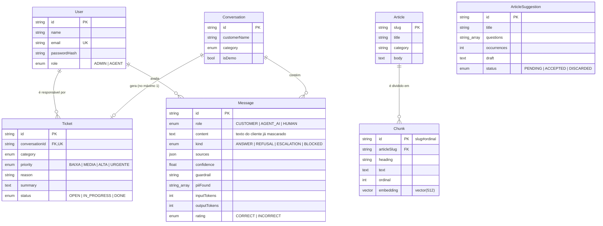

# Modelo de dados

PostgreSQL com a extensão `vector` (pgvector). O esquema fica em [`prisma/schema.prisma`](../../prisma/schema.prisma) e as migrações em `prisma/migrations/`.

## Decisões de modelagem
| Decisão | Motivo | Trade-off |
|---|---|---|
| **A mensagem do cliente é guardada já mascarada** (RN-06) | O dado original nunca toca o banco. | Não dá para recuperar o CPF digitado, nem para depurar com ele. É de propósito. |
| **`kind`, `confidence`, `sources` e `guardrail` por mensagem** (RNF-09) | Auditar *por que* o agente fez o que fez, na tela do chamado. | Mais colunas; `sources` é JSON sem esquema rígido. |
| **Um chamado por conversa** (`conversationId` único, RN-11) | Evita fila duplicada para o mesmo cliente. | Uma segunda questão sensível na mesma conversa reaproveita o chamado. |
| **Lacunas não têm tabela:** são derivadas das mensagens `REFUSAL` | Uma fonte de verdade só, e o agrupamento pode mudar sem migração. | O agrupamento roda em memória a cada abertura da tela. Com muito volume precisaria virar tabela ou visão materializada. |
| **`Chunk.embedding` com `vector(512)`** | Dimensão do embedder atual. | Trocar de embedder exige regerar os vetores e possivelmente mudar a dimensão. |
| **Sem tabela de cliente final** | Fora do escopo (sem multiempresa). A conversa guarda só um nome informado. | Não dá para ver o histórico de um mesmo cliente entre conversas. |
