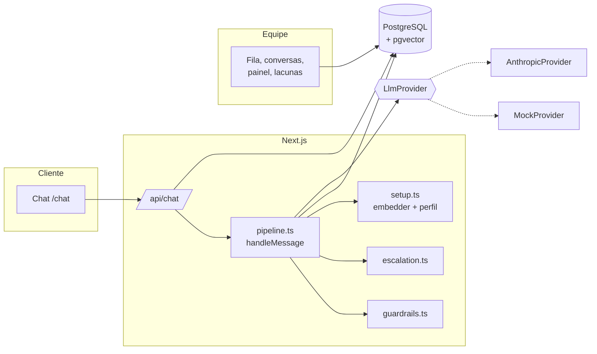
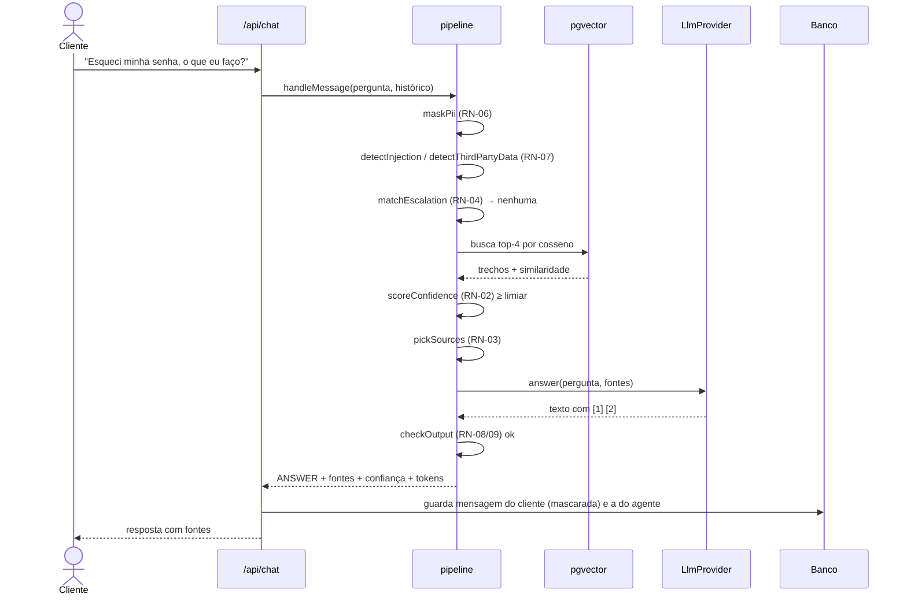
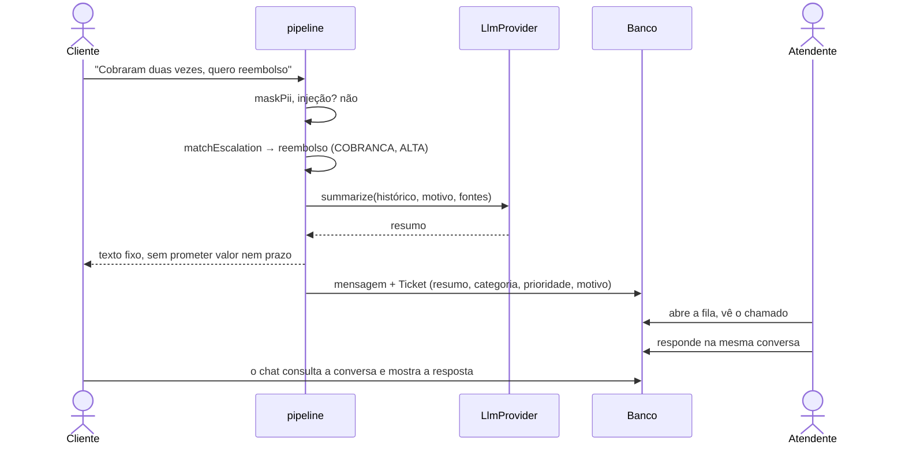

# Fluxo da resposta e modos de falha

## Visão geral dos componentes

## Sequência: pergunta respondível

## Sequência: pedido sensível

## Modos de falha
| Falha | O que acontece | Regra | Teste |
|---|---|---|---|
| **API do modelo fora** ou erro de rede (`ProviderError`) | O cliente **não fica sem resposta**: vira encaminhamento (prioridade Média) com resumo por template. | RN-10 | `pipeline.test.ts` "provedor falha" |
| **Resumo falha** durante o escalonamento | O chamado é criado com resumo simples (pergunta + motivo). O escalonamento nunca falha por causa do modelo. | RN-10 | idem |
| **Busca vetorial fora** | Tratada como confiança zero: o agente recusa e oferece uma pessoa. | RN-10 | `pipeline.test.ts` "falha da busca" |
| **Busca sem resultado** | Confiança zero → recusa honesta, e a pergunta entra nas lacunas. | RN-02 | `pipeline.test.ts` "admite que não sabe" |
| **Modelo responde com preço ou promessa fora da fonte** | A resposta é descartada e vira encaminhamento com o motivo. | RN-08/09 | `pipeline.test.ts` (2 testes) |
| **Modelo vaza o marcador do prompt** | Bloqueado pelo filtro de saída. | RN-07 | `security.test.ts` |
| **Banco fora** | A API responde 500 com mensagem genérica e o chat mostra um alerta, continuando utilizável. **Não há fila de reenvio.** | — | E2E "erro do servidor" (simula o 500) |
| **Embedder trocado sem regerar vetores** | Busca com lixo. Não há checagem de versão. | — | **Sem teste.** Risco conhecido, no roadmap. |
