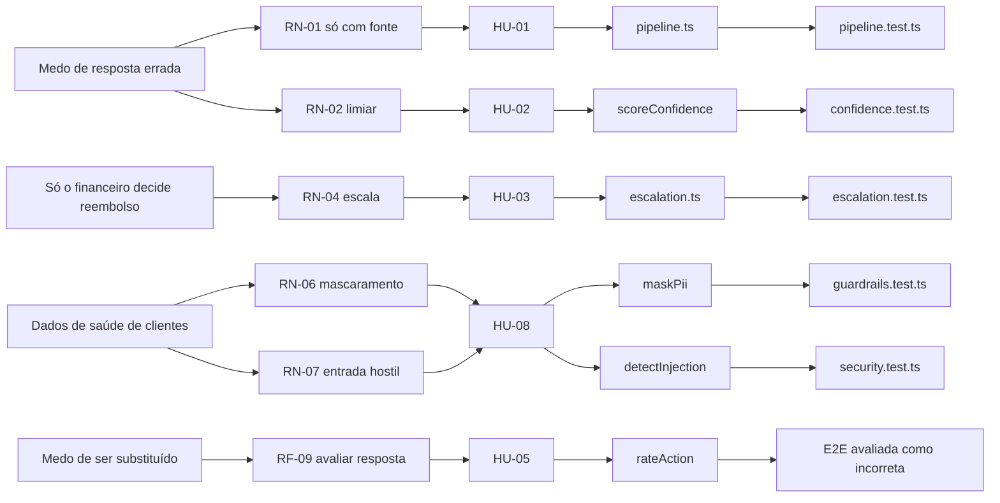

# 03 · Requisitos e rastreabilidade

[← Índice do ciclo de vida](README.md) · [← 02 Planejamento](02-planejamento-e-scrum.md) · Próximo: [04 · Arquitetura](04-arquitetura-e-adrs.md)

Os requisitos completos estão em [requisitos](../02-definicao/requisitos.md) (15 RF e 9 RNF), [regras de negócio](../02-definicao/regras-de-negocio.md) (12 RN) e [histórias](../02-definicao/historias-e-moscow.md) (11 HU, com critérios de aceite e MoSCoW). Este documento mostra como as necessidades chegam a eles e ao código.

## Da necessidade ao teste

## Necessidade → requisito → história → regra → código → teste
| Necessidade (origem) | Requisito | História | Regra | Código | Teste |
|---|---|---|---|---|---|
| Resposta sempre com base (líder) | RF-02, RF-03 | HU-01 | RN-01, RN-03 | `pipeline.ts`, `pickSources` | `pipeline.test.ts`, `confidence.test.ts`, E2E "resposta com fontes" |
| Admitir que não sabe (líder) | RF-04 | HU-02 | RN-02 | `scoreConfidence` | `confidence.test.ts`, E2E "recusa honesta" |
| Dinheiro e identidade vão ao humano (líder, financeiro) | RF-05, RF-08 | HU-03 | RN-04, RN-05, RN-11 | `escalation.ts`, `buildHandoff` | `escalation.test.ts`, `pipeline.test.ts` |
| Contexto para o atendente (atendente) | RF-06, RF-07 | HU-04 | RN-05 | `tickets/` | E2E "fila" |
| Controle de qualidade (atendente) | RF-09 | HU-05 | — | `rateAction` | E2E "avaliada como incorreta" |
| Ver o que falta na base (líder) | RF-10, RF-11 | HU-06, HU-07 | — | `metrics.ts`, `gaps.ts` | `kb-and-metrics.test.ts` |
| Proteger dados e regras (cliente-tipo, líder) | RNF-03 | HU-08 | RN-06 a RN-09 | `guardrails.ts` | `guardrails.test.ts`, `security.test.ts` |
| Medir sem se enganar | RF-12 | HU-09 | — | `eval/` | execuções em `docs/04-avaliacao/` |
| Acesso por papel | RF-15, RNF-05 | HU-10 | — | `auth.ts`, `requireUser` | E2E "rotas exigem login" |
| Virar lacuna em conteúdo (retrospectiva) | RF-13 | HU-11 | RN-12 | `suggestions.ts` | `suggestions.test.ts`, E2E v1.1 |

Itens sem linha na matriz oficial: RN-01, 03, 11, 12 e RNF-01 a 04, 06, 08, 09 ([nota na rastreabilidade](../02-definicao/rastreabilidade.md)). Nesta tabela, RN-01, RN-03, RN-11 e RN-12 foram associados a código e teste; RNF-01 a RNF-04, RNF-06, RNF-08 e RNF-09 continuam sem linha de rastreio completa.

## Partes interessadas (RACI das decisões do produto)
R = responsável, A = aprovador, C = consultado, I = informado.

| Decisão | Analista | Líder de suporte | Atendente | Financeiro | Cliente-tipo |
|---|---|---|---|---|---|
| Escopo e prioridades | R | A | C | I | C |
| Assuntos que sempre escalam | R | A | C | A | I |
| Mascaramento e privacidade | R | C | I | I | A |
| Fluxo da fila e avaliação das respostas | R | C | A | I | I |
| Critérios de aceite | R | A | C | C | C |

## Mudanças de escopo
| Pedido | Origem | Decisão | Registro |
|---|---|---|---|
| Mostrar a conversa completa no chamado | Atendente | Aceito | [Sprint 2](sprints/sprint-2.md) |
| Painel sem produtividade individual | Atendente | Aceito | RF-10, [reunião 2](../01-discovery/04-reuniao-2-atendente.md) |
| Mascarar dados antes de guardar e enviar ao modelo | Cliente-tipo | Aceito | RN-06 |
| Avaliar também conversas sem chamado | Qualidade (sprint 3) | Aceito | RF-09, [Sprint 3](sprints/sprint-3.md) |
| Sugestão de artigos a partir de lacunas | Retrospectiva | Aceito (v1.1) | RF-13, RN-12 |
| Integração com WhatsApp e voz | Discovery | Fora desta versão | MoSCoW "Won't" |
| Sugestão de resposta ao atendente (ideia D) | Matriz de decisão | Adiado | [brainstorm](../01-discovery/01-brainstorm-e-matriz.md) |
| Reembolso decidido pelo agente | Hipótese descartada | Recusado | RN-04, RN-09 |

## Critérios de aceite dos fluxos principais
| Fluxo | Critério | Verificação |
|---|---|---|
| Pergunta respondível | Resposta com fontes citadas e abertas no chat | E2E, print 01 |
| Pergunta fora da base | "Não tenho essa informação", sem fontes, com botão de pessoa | E2E, print 02 |
| Pedido sensível | Encaminhamento sem prometer valor, prazo ou reembolso | E2E, print 03 |
| Injeção de prompt | Bloqueio antes do modelo | `security.test.ts`, print 09 |
| Fila | Chamado com resumo, categoria, prioridade e motivo | E2E, prints 04 e 05 |

A reunião de aceitação com o veredito por história está em [reuniao-de-aceitacao.md](../05-qualidade/reuniao-de-aceitacao.md).
