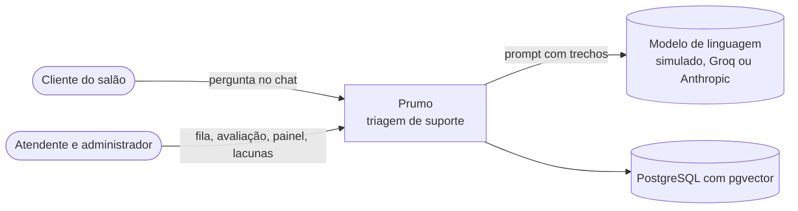
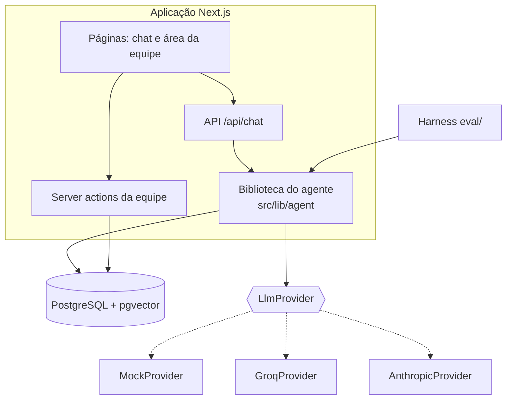
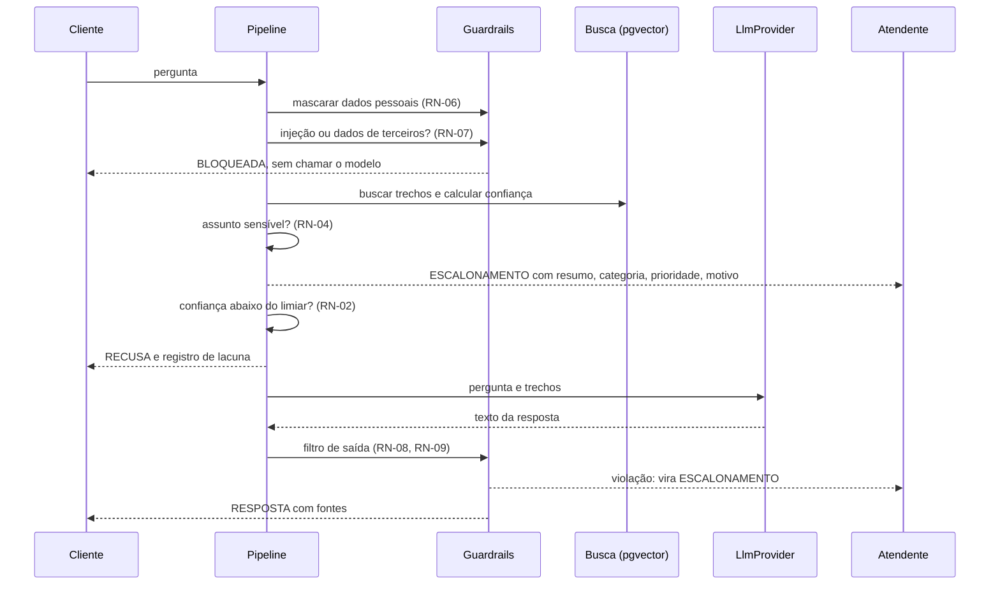
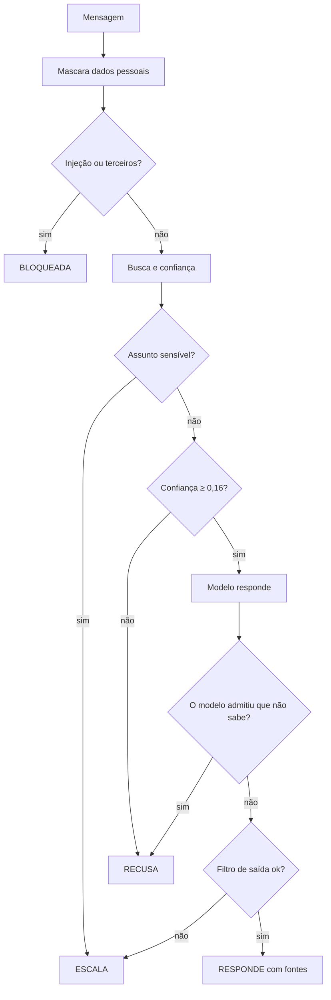
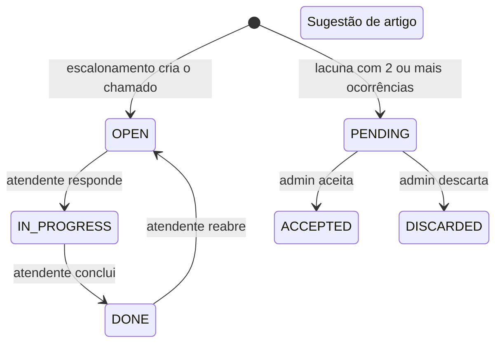

# 04 · Arquitetura e ADRs

[← Índice do ciclo de vida](README.md) · [← 03 Requisitos](03-requisitos-e-rastreabilidade.md) · Próximo: [05 · Modelo de dados](05-modelo-de-dados.md)

Os diagramas representam o código atual (`src/lib/agent/pipeline.ts` e arredores). A versão detalhada dos modos de falha está em [sequencia-e-falhas.md](../03-arquitetura/sequencia-e-falhas.md).

## Contexto (C4, nível 1)

## Contêineres (C4, nível 2)

O harness de avaliação usa a mesma biblioteca do agente com busca em memória; a paridade com o pgvector é testada ([ADR-002](../03-arquitetura/decisoes.md#adr-002--embeddings-locais-e-pgvector)).

## Componentes do agente
| Componente | Arquivo | Responsabilidade |
|---|---|---|
| Pipeline | `pipeline.ts` | Orquestra a sequência de decisão (`handleMessage`) |
| Guardrails | `guardrails.ts` | Mascaramento de dados, injeção, dados de terceiros, filtro de saída |
| Escalonamento | `escalation.ts` | Regras de assuntos sensíveis, categoria e prioridade |
| Base e embedder | `kb.ts`, `embedder.ts`, `store.ts` | Trechos, embedding por hashing, busca (memória e pgvector) |
| Provedores | `providers.ts` | Interface `LlmProvider` e três implementações |
| Lacunas e sugestões | `gaps.ts`, `suggestions.ts` | Agrupamento de perguntas sem resposta e rascunho de artigo |

## Sequência: pergunta → busca → verificação → resposta ou escalonamento

Cada alternativa de saída é excludente: o pipeline retorna na primeira condição verdadeira, na ordem do diagrama.

## Árvore de decisão: responder, recusar ou escalar

## Estados do chamado e da sugestão de artigo

As transições vêm de `src/app/(staff)/actions.ts`: o status pode ser alterado livremente entre os três valores pelo atendente; `resolvedAt` só é preenchido em `DONE`.

## Decisões (ADRs)
| ADR | Decisão | Principal consequência |
|---|---|---|
| [001](../03-arquitetura/decisoes.md#adr-001--rag-vs-ajuste-fino-vs-regras) | RAG com citação | Atualizar um artigo atualiza o agente; a qualidade depende da busca |
| [002](../03-arquitetura/decisoes.md#adr-002--embeddings-locais-e-pgvector) | Embedding local por hashing e pgvector | Roda sem rede; não é busca semântica |
| [003](../03-arquitetura/decisoes.md#adr-003--tamanho-dos-trechos) | Trechos por seção | 93 trechos de 31 artigos |
| [004](../03-arquitetura/decisoes.md#adr-004--limiar-de-confiança-e-como-medi-lo) | Confiança com cobertura, limiar 0,16 e cobertura 0,4 | Recusa correta de 20% a 80%; F01 e F03 não se separam |
| [005](../03-arquitetura/decisoes.md#adr-005--política-de-citação) | Até 3 trechos, no máximo 2 por artigo | Corrige o preço errado; benefício com modelo real é hipótese |
| [006](../03-arquitetura/decisoes.md#adr-006--mascaramento-de-dados-pessoais) | Mascaramento antes de guardar e enviar | Nomes e endereços não são mascarados |
| [007](../03-arquitetura/decisoes.md#adr-007--prompt-injection) | Quatro camadas contra injeção | 100% nos testes é piso, não garantia |
| [008](../03-arquitetura/decisoes.md#adr-008--abstração-do-provedor-de-linguagem) | Interface de provedor | Testes sem chave; provedor simulado não mede a redação do modelo |
| [009](../03-arquitetura/decisoes.md#adr-009--autenticação-e-sessão) | Sessão própria com papéis | Sem limite de tentativas de login |
| [010](../03-arquitetura/decisoes.md#adr-010--como-avaliar-sem-se-enganar) | Conjuntos de desenvolvimento e validação | Amostra pequena, mesmo autor |

## Requisitos de qualidade
| Atributo | Tratamento | Limite conhecido |
|---|---|---|
| Segurança | Guardrails, sessão com cookie assinado, guarda por página e ação | Sem limite de tentativas de login; ver [segurança](seguranca-e-confiabilidade.md) |
| Confiabilidade | O cliente nunca fica sem resposta (RN-10) | Sem fila de reenvio com o banco fora |
| Desempenho | Busca sobre 93 trechos, sem índice aproximado | Não medido com o modelo real; sem teste de carga |
| Manutenibilidade | Provedor atrás de interface; regras em arquivos pequenos | Embedder trocado sem regerar vetores não é detectado |
| Observabilidade | Cada mensagem guarda confiança, fontes e guardrail; painel de métricas | Sem logs estruturados nem alertas |
