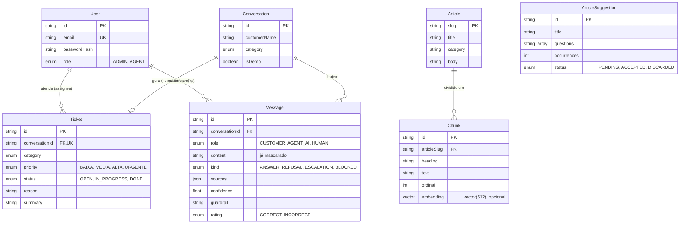

# 05 · Modelo de dados

[← Índice do ciclo de vida](README.md) · [← 04 Arquitetura](04-arquitetura-e-adrs.md) · Próximo: [06 · Desenvolvimento e configuração](06-desenvolvimento-e-configuracao.md)

Fonte: `prisma/schema.prisma` e as migrations `20261023155642_init` e `20261023161404_add_article_suggestions`. O diagrama mostra só o que está implementado. O texto das decisões de modelagem está em [modelo-de-dados.md](../03-arquitetura/modelo-de-dados.md).

## Modelo entidade-relacionamento

`ArticleSuggestion` não tem chave estrangeira: é derivada das lacunas, que são mensagens `REFUSAL`, e não guarda referência a elas.

## Dicionário de dados (principais colunas)
| Entidade.coluna | Tipo | Restrição | Descrição |
|---|---|---|---|
| `User.email` | texto | único | Login da equipe |
| `User.passwordHash` | texto | obrigatório | Hash de senha com sal (`scrypt`) |
| `Article.slug` | texto | chave primária | Identificador do artigo em `kb/` |
| `Chunk.embedding` | `vector(512)` | opcional | Embedding por hashing do trecho |
| `Chunk.articleSlug` | texto | FK, `ON DELETE CASCADE` | Artigo de origem |
| `Message.content` | texto | obrigatório | Texto do cliente guardado já mascarado (RN-06) |
| `Message.kind` | enum | opcional | Resultado: resposta, recusa, escalonamento ou bloqueio |
| `Message.sources` | JSON | opcional | Trechos citados, sem esquema rígido |
| `Message.confidence` | decimal | opcional | Confiança da busca para aquela resposta |
| `Message.guardrail` | texto | opcional | Regra que disparou (por exemplo `escalonamento:reembolso`) |
| `Message.piiFound` | lista de texto | padrão vazio | Tipos de dado pessoal mascarados |
| `Message.rating` | enum | opcional | Avaliação do atendente |
| `Ticket.conversationId` | texto | FK, único | Um chamado por conversa (RN-11) |
| `Ticket.status` | enum | padrão `OPEN` | Estado do atendimento |
| `Ticket.resolvedAt` | data e hora | opcional | Preenchido ao concluir |
| `Conversation.isDemo` | booleano | padrão falso | Marca as conversas de demonstração |

## Restrições e índices
| Objeto | Tipo | Finalidade |
|---|---|---|
| `User_email_key` | único | Impede e-mail duplicado |
| `Ticket_conversationId_key` | único | Um chamado por conversa |
| `Chunk_articleSlug_idx` | índice | Buscar os trechos de um artigo |
| `Message_conversationId_createdAt_idx` | índice composto | Ler a conversa em ordem |
| `Message_kind_idx` | índice | Contar recusas e escalonamentos no painel e nas lacunas |
| `Ticket_status_priority_idx` | índice composto | Ordenar a fila por status e prioridade |
| Chaves estrangeiras | `ON DELETE CASCADE` em `Chunk`, `Message` e `Ticket` | Apagar um artigo ou uma conversa leva os dependentes |

**Não há índice de similaridade** (HNSW ou IVFFlat) em `Chunk.embedding`. Com 93 trechos, a busca por cosseno (`<=>`) percorre a tabela inteira. Um índice aproximado é uma evolução possível se a base crescer, e não está implementado.

## Normalização
O esquema está em 3FN para as entidades de domínio, com três desnormalizações deliberadas: `Message.sources` é JSON (o trecho citado precisa permanecer como era no momento da resposta), `Message.category` não existe (a categoria fica em `Conversation` e `Ticket`) e `Ticket.summary` guarda o resumo gerado na hora do escalonamento. `ArticleSuggestion.questions` é uma lista de texto, para não criar uma tabela de uma coluna.

## Criação, atualização e consulta
| Operação | Quem | Como |
|---|---|---|
| Criar conversa e mensagens | Chat do cliente | `api/chat` → `handleMessage`; a mensagem do cliente é mascarada antes de gravar |
| Criar chamado | Pipeline, ao escalonar | `createTicket`; reaproveita o chamado se já existir (RN-11) |
| Atualizar chamado | Atendente | Server actions: responder, mudar status |
| Avaliar resposta | Atendente | `rateAction` grava `rating`, `ratedById` e `ratedAt` |
| Consultar lacunas | Admin e atendente | Leitura de mensagens `REFUSAL`, agrupadas em memória |
| Consultar painel | Admin | Agregações sobre `Message` e `Ticket` (`metrics.ts`) |

## Migrations e seeds
| Migration | Conteúdo |
|---|---|
| `20261023155642_init` | Extensão `vector`, tipos, tabelas, índices e chaves |
| `20261023161404_add_article_suggestions` | Tabela `ArticleSuggestion` (v1.1) |

`npm run db:seed` cria 2 usuários, 31 artigos e 93 trechos com vetores; `npm run db:demo` apaga todas as conversas e recria 32 conversas e 9 chamados de demonstração, marcadas com `isDemo` ([CONTRIBUTING](../../CONTRIBUTING.md)).

## Consistência, idempotência e transações
- O chamado único por conversa é garantido por restrição de unicidade, e não apenas por código.
- O escalonamento não depende do modelo: se o resumo falhar, o chamado é criado com resumo simples (RN-10).
- Não há fila de reenvio: com o banco fora, a API responde 500 e o chat mostra um alerta.
- `db:demo` apaga todas as conversas antes de recriar as de demonstração; não preserva conversas existentes.

## Privacidade, retenção e acesso
- Dados pessoais de formato conhecido (CPF, CNPJ, e-mail, telefone, cartão) são trocados por marcadores antes de gravar; nomes e endereços não são mascarados ([ADR-006](../03-arquitetura/decisoes.md#adr-006--mascaramento-de-dados-pessoais)).
- Não existe política de retenção nem rotina de expurgo implementada.
- Não existe trilha de auditoria além de `ratedBy`, `assignee` e dos campos de data.
- O acesso à área da equipe exige sessão e respeita os papéis `ADMIN` e `AGENT`.
