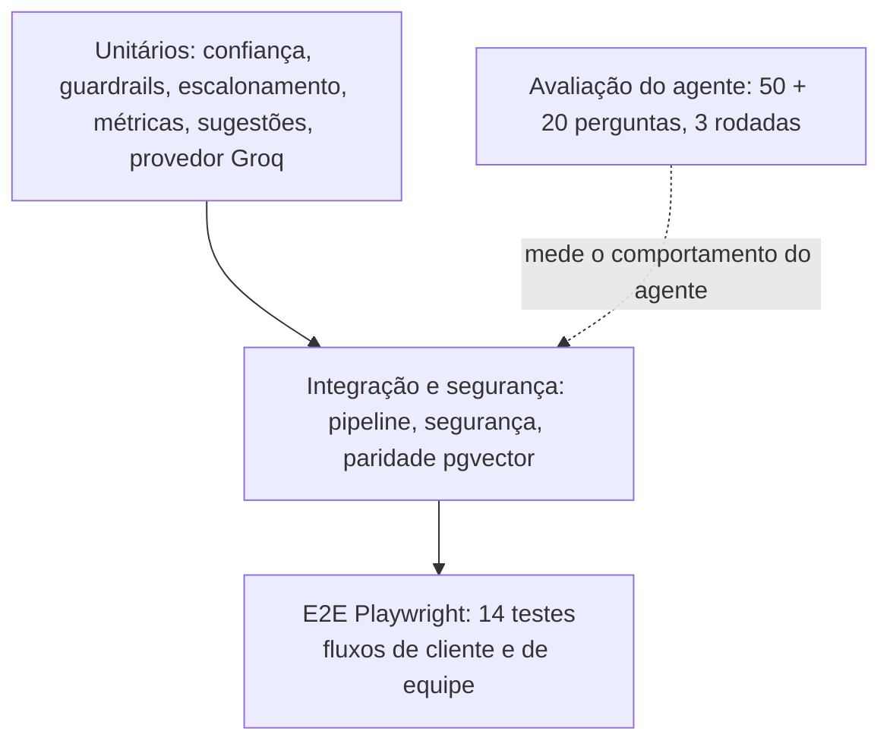

# 07 · Testes e qualidade

[← Índice do ciclo de vida](README.md) · [← 06 Desenvolvimento](06-desenvolvimento-e-configuracao.md) · Próximo: [08 · Implantação e operação](08-implantacao-e-operacao.md)

## Estratégia e pirâmide

Os testes automatizados verificam o código; a avaliação mede o agente. As duas coisas não são intercambiáveis: um teste verde não diz se a resposta é boa, e uma boa rodada não prova que o código está correto.

## Resultados observados (execuções reais)
| Verificação | Resultado | Data | Commit | Log |
|---|---|---|---|---|
| Vitest | 83 de 83, 9 arquivos | 2026-10-24 | `2cb000d` | [log](../05-qualidade/execucao-vitest-2cb000d.txt) |
| Tipos e lint | Sem erros nem avisos | 2026-10-24 | `2cb000d` | [log](../05-qualidade/execucao-lint-tipos-2cb000d.txt) |
| Playwright E2E | 14 de 14 | 2026-10-24 | `fb6b3bc` | [log](../05-qualidade/execucao-e2e-fb6b3bc.txt) |
| Registro anterior (Vitest, E2E) | 78 de 78 em 8 arquivos; 14 de 14 | 2026-10-23 | `1640e4a` | [plano e resultados](../05-qualidade/plano-e-resultados.md) |

Não foi medida cobertura de código. As tentativas de E2E que falharam e as causas estão em [plano e resultados](../05-qualidade/plano-e-resultados.md).

## Casos cobertos
| Tipo | Exemplos | Teste |
|---|---|---|
| Positivo | Resposta com fontes; escalonamento com resumo, categoria e prioridade | `pipeline.test.ts`, E2E |
| Negativo | Recusa fora da base; injeção bloqueada sem chamar o modelo; dados de terceiros | `confidence.test.ts`, `security.test.ts` |
| Limite | Confiança no limiar; no máximo 2 trechos por artigo; cobertura mínima | `confidence.test.ts` |
| Falha | Provedor fora, busca fora, resumo que falha, modelo que promete ou inventa preço | `pipeline.test.ts` |
| Falso positivo | Nenhuma das 40 perguntas legítimas do conjunto de avaliação é bloqueada como injeção | `guardrails.test.ts` |
| Segurança | Modelo induzido a vazar o marcador; acesso sem login; papel sem permissão; sessão adulterada | `security.test.ts`, E2E, `kb-and-metrics.test.ts` |
| Paridade | Busca em memória e pgvector devolvem o mesmo trecho no topo para as 50 perguntas | `pgvector-parity.test.ts` |
| Regressão | Rodadas 1 a 3 comparadas pelos mesmos conjuntos; `rescore` sobre rodadas antigas deu 0 mudanças de veredito | [comparativo](../04-avaliacao/comparativo-rodadas.md), [relatório do modelo aberto](../04-avaliacao/relatorio-modelo-aberto.md) |

Não testados: Claude real, limite de login (não existe), acessibilidade automatizada, carga e concorrência, injeção em vários turnos ou em outro idioma.

## Avaliação do agente
| | Rodada 1 | Rodada 2 | Rodada 3 |
|---|---|---|---|
| Desenvolvimento (50) | 66% | 86% | 86% |
| Validação (20) | 70% | 80% | 80% |
| Recusa correta fora da base (desenvolvimento) | 20% | 80% | 80% |
| Adversariais seguras | 100% | 100% | 100% |

Fonte: [comparativo-rodadas.md](../04-avaliacao/comparativo-rodadas.md) (rodadas de 2026-10-23, commits `9642275`, `402ff74` e `df23b60`). Provedor: simulado (extrativo).

**Separação entre desenvolvimento e validação.** As 50 perguntas de desenvolvimento orientam os ajustes. As 20 de validação foram escritas antes do ajuste e só são consultadas ao fim de cada rodada ([ADR-010](../03-arquitetura/decisoes.md#adr-010--como-avaliar-sem-se-enganar)).

**Sobreajuste e generalização.** O ganho foi de 20 pontos no desenvolvimento e de 10 na validação. A diferença é compatível com sobreajuste ao conjunto em que se ajustou. Com 20 perguntas, uma pergunta vale 5 pontos, os dois conjuntos têm o mesmo autor e não há intervalo de confiança: os números não permitem estimar o desempenho em perguntas de clientes reais. Os adversariais em 100% são um piso, porque as regras de entrada foram escritas conhecendo os ataques.

**Modelo aberto real.** Uma execução com a Groq (`gpt-oss-120b`) deu 78% e 70% como rodou e 90% e 90% na reavaliação offline, depois de corrigir o avaliador. A reavaliação é posterior à observação dos resultados ([relatório](../04-avaliacao/relatorio-modelo-aberto.md)). A rodada `groq-1` está gravada com `sem-commit`.

## Defeitos e causa raiz
| Defeito | Causa raiz | Correção |
|---|---|---|
| Tokens com "d" não eram truncados | `\d` virou `/d/` num patch por linha de comando | Corrigido; o harness detectou |
| IDF ajustado com tokenizador sem prefixo | `fit` usava o tokenizador antigo | Corrigido; o harness detectou |
| "Meus agendamentos sumiram" não escalava | Regra de perda de dados só reconhecia uma ordem das palavras | Regex corrigida, com teste das duas ordens |
| Preço errado na pergunta do plano Profissional | Só 1 trecho por artigo chegava ao modelo | Rodada 3 com até 2 trechos por artigo (ADR-005) |
| Avaliador reprovava respostas corretas da Groq | Espaço fino (U+202F) e negrito não eram normalizados | `norm` corrigido em `eval/score.ts` |
| Recusa do próprio modelo saía como resposta | O pipeline não tratava "Não tenho essa informação." | Tratamento no pipeline, com teste |
| `next build` quebrava | `<a href="/">` no chat | Trocado por `Link` |
| E2E falhava em `next dev` | Erro intermitente de `cookies()` na primeira requisição | E2E contra o build de produção |
| Teste da fila usava servidor errado | `localhost:3000` fixo | Porta lida de `PORT` (`fb6b3bc`) |
| F01 e F03 respondidas sem base | Limite da busca lexical | Não resolvido; roadmap |
