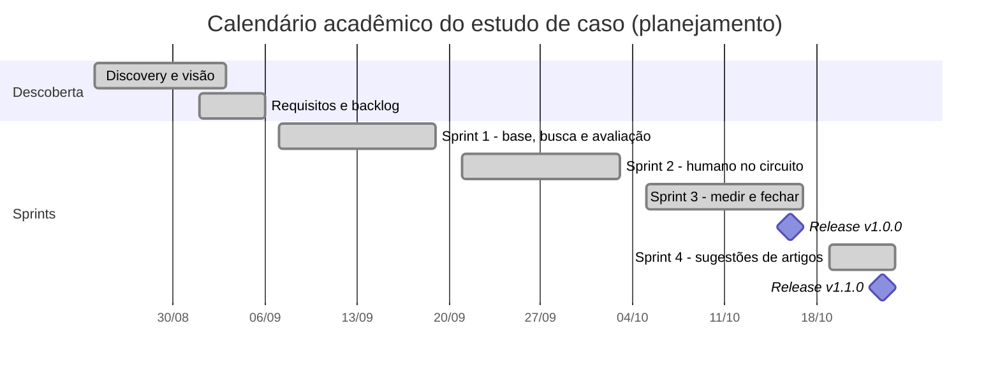

# Ciclo de vida do Prumo

Relatório do ciclo de vida do produto, da descoberta do problema à evolução. Cada documento liga o problema a requisito, decisão, implementação, teste e resultado. Voltar à [capa](../../README.md) · [guia da série](../INDEX.md) · [glossário](../GLOSSARIO.md).

## Documentos
| # | Documento | Conteúdo |
|---|---|---|
| 01 | [Visão e discovery](01-visao-e-discovery.md) | Problema, personas por papel, escopo, restrições, critérios de sucesso, reuniões |
| 02 | [Planejamento e Scrum](02-planejamento-e-scrum.md) | Product Goal, backlog priorizado, release plan, DoR e DoD, riscos |
| 03 | [Requisitos e rastreabilidade](03-requisitos-e-rastreabilidade.md) | Necessidade → requisito → história → regra → código → teste, RACI, mudanças |
| 04 | [Arquitetura e ADRs](04-arquitetura-e-adrs.md) | Contexto, contêineres, componentes, sequência, estados, decisões |
| 05 | [Modelo de dados](05-modelo-de-dados.md) | ER, dicionário, índices, migrations, seeds, privacidade |
| 06 | [Desenvolvimento e configuração](06-desenvolvimento-e-configuracao.md) | Git, commits, versões, PRs, ambientes, dívida técnica |
| 07 | [Testes e qualidade](07-testes-e-qualidade.md) | Estratégia, resultados observados, avaliação em 3 rodadas, defeitos |
| 08 | [Implantação e operação](08-implantacao-e-operacao.md) | O que existe, o que é plano: rollout, rollback, treinamento, monitoramento |
| 09 | [Evolução e roadmap](09-evolucao-e-roadmap.md) | Versões, mudanças, dívida técnica, próximos passos, lições |
| — | [Segurança e confiabilidade](seguranca-e-confiabilidade.md) | Ameaças, controles, modos de falha e limites |
| — | [Reuniões](reunioes/README.md) · [Sprints](sprints/README.md) · [Diagramas](diagramas/README.md) | Atas, uma página por sprint, índice de diagramas |

## Linha do tempo
O cronograma abaixo é o calendário acadêmico do estudo de caso (planejamento). As datas reais dos commits e das execuções técnicas estão em [06](06-desenvolvimento-e-configuracao.md) e [07](07-testes-e-qualidade.md), e não coincidem com este calendário.

## Marcos e evidências
| Marco | Evidência no repositório |
|---|---|
| Discovery e matriz de decisão | [brainstorm](../01-discovery/01-brainstorm-e-matriz.md), [atas](reunioes/README.md) |
| Núcleo do agente e harness de avaliação | commit `9642275` |
| Rodadas 1 a 3 de avaliação | [comparativo](../04-avaliacao/comparativo-rodadas.md) |
| v1.0.0 | tag `v1.0.0` (commit `f0240fe`) |
| v1.1.0 | tag `v1.1.0` (commit `1640e4a`) |
| Rodada com modelo aberto real (Groq) | [relatório](../04-avaliacao/relatorio-modelo-aberto.md) |

Nota de método: ver a [nota de contexto acadêmico](../../README.md#nota-de-contexto-acadêmico) da capa.
