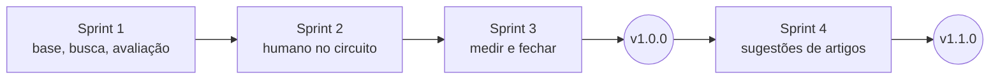

# Sprints

[← Índice do ciclo de vida](../README.md) · [02 · Planejamento e Scrum](../02-planejamento-e-scrum.md)

As datas são do calendário acadêmico do estudo de caso; os commits têm as datas reais do Git ([06](../06-desenvolvimento-e-configuracao.md)). Cada página traz objetivo, escopo, entregáveis, critérios de conclusão, evidência e os registros de planning, review e retrospectiva do cenário.

| Sprint | Período (calendário acadêmico) | Release |
|---|---|---|
| [1](sprint-1.md) | 07/09 a 18/09/2026 | — |
| [2](sprint-2.md) | 21/09 a 02/10/2026 | — |
| [3](sprint-3.md) | 05/10 a 16/10/2026 | v1.0.0 |
| [4](sprint-4.md) | 19/10 a 23/10/2026 | v1.1.0 |
